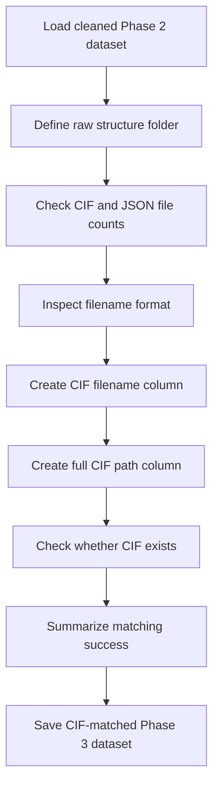

## Phase 3A Workflow — Match Phase 2 Dataset to CIF Files

**Goal:**  
Use the cleaned Phase 2 linker-extracted dataset as the base dataset and match each MOF record to its corresponding CIF structure file.

### Workflow

| Step | Purpose | Output |
|---|---|---|
| Load Phase 2 dataset | Use cleaned RDKit/linker dataset as Phase 3 base | `df` |
| Define raw folder | Point Python to folder containing CIF/JSON files | `raw_structure_dir` |
| Count files | Confirm raw structure files are available | CIF and JSON counts |
| Inspect filename | Check whether `.cif` extension is already present | Filename format |
| Create CIF filename | Convert `hMOF-0` to `hMOF-0.cif` | `cif_filename` |
| Create CIF path | Build full path to each CIF file | `cif_path` |
| Check CIF exists | Verify matching CIF file is available | `cif_found` |
| Save matched data | Store Phase 3A result for next steps | `hmof_phase3_cif_matched.csv` |