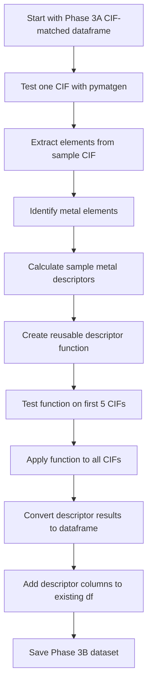

# Phase 3B — Extract Metal-Node Descriptors

**Goal:**  
Extract metal-node descriptors from matched CIF structures, including metal identity, metal counts, selected elemental properties, and exploratory oxidation-state/open-metal-site indicators.

**Why this matters:**  
Metal nodes can strongly influence CO₂ adsorption, especially at low pressure, because metal identity, charge environment, and coordination sites can affect CO₂ binding strength.

## Phase 3B Metal-Node Descriptor Plan

| Descriptor | Group | Meaning | Reliability |
|---|---|---|---|
| `metal_elements` | Metal identity/composition | List of metal elements present in each MOF, such as `Zn`, `Cu`, `Co`, or `Ni` | High |
| `num_metal_types` | Metal identity/composition | Number of distinct metal elements present in the structure | High |
| `total_metal_atoms` | Metal identity/composition | Total number of metal atoms in the CIF structure | High |
| `metal_fraction` | Metal identity/composition | Fraction of atoms in the structure that are metals | High |
| `avg_metal_atomic_number` | Elemental properties | Average atomic number of the metal atoms in the structure | High |
| `avg_metal_atomic_mass` | Elemental properties | Average atomic mass of the metal atoms in the structure | High |
| `estimated_oxidation_state` | Oxidation state | Estimated oxidation state of metal centers, if assignment is reliable | Investigate |
| `possible_open_metal_site` | Open metal sites | Indicator of possible under-coordinated metal centers, if assignment is reliable | Investigate |

### pymatgen
**pip install pymatgen**


**Starting dataset:**  

```text
data/processed/hmof_phase3_cif_matched.csv
```

**Output dataset:**  

```text
data/processed/hmof_phase3_metal_descriptors.csv
```

### Workflow



### Descriptor Columns Added

| Column | Meaning |
|---|---|
| `metal_elements` | Metal elements present in the MOF structure |
| `num_metal_types` | Number of distinct metal elements |
| `total_metal_atoms` | Total number of metal atoms in the CIF structure |
| `total_atoms` | Total number of atoms in the CIF structure |
| `metal_fraction` | Fraction of atoms that are metal atoms |

### Important Distinction

| Feature | Meaning | Example from `hMOF-0` |
|---|---|---|
| `num_metal_types` | Number of different metal elements | `1` because only Zn is present |
| `total_metal_atoms` | Number of metal atoms in the CIF | `4` Zn atoms |
| `metal_fraction` | Metal atoms divided by total atoms | `4 / 53 = 0.075` |

### Sample Check

For the sample CIF:

```text
hMOF-0.cif
```

pymatgen parsed the structure as:

```text
Zn4 H12 C24 O13
```

This gave:

| Descriptor | Value |
|---|---:|
| `metal_elements` | `['Zn']` |
| `num_metal_types` | `1` |
| `total_metal_atoms` | `4` |
| `total_atoms` | `53` |
| `metal_fraction` | `0.075` |

### Conclusion

Phase 3B extracts basic and reproducible metal-node descriptors from the matched CIF structures. These descriptors are added directly to the existing Phase 3 dataframe and saved for later descriptor expansion and modeling.